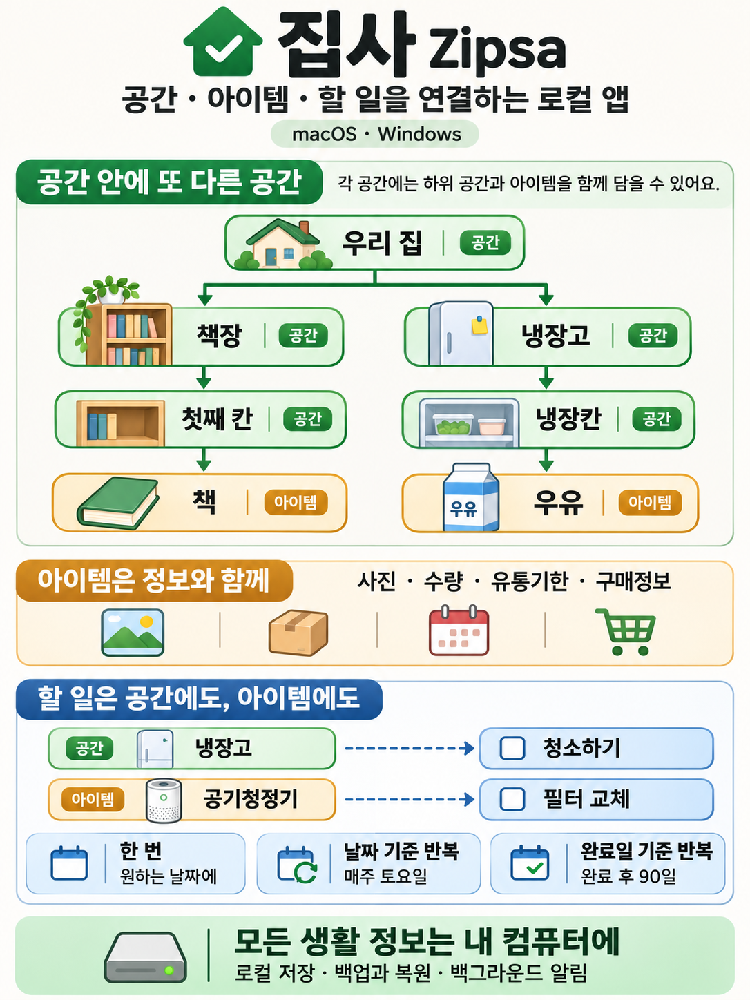

# 집사 · Zipsa

집·사무실의 공간, 물품, 관리할 일을 내 컴퓨터에서 관리하는 macOS·Windows 데스크톱 앱입니다. Tauri 2, React, TypeScript, Rust, SQLite로 구성합니다. 로그인과 데이터 서버는 사용하지 않습니다.

첫 버전의 대상은 macOS 13 이상(Apple Silicon·Intel)과 Windows 10 이상(x64, WebView2 설치)입니다.



## 실행

Node.js 22.12 이상(권장 24 LTS), Rust 1.90 이상과 [운영체제별 Tauri 개발 도구](https://v2.tauri.app/start/prerequisites/)가 필요합니다. macOS에는 Xcode Command Line Tools, Windows에는 Visual Studio C++ Build Tools와 WebView2가 필요합니다.

```sh
npm ci
npm run desktop
```

`npm run dev`는 개발용 화면 서버만 실행합니다. 데이터 저장과 시스템 기능을 사용하려면 `npm run desktop`으로 실행하세요. 제품은 웹 서버 없이 설치된 앱 안에서 동작합니다.

## 첫 버전의 기능

- 공간 트리: 최상위 공간 여러 개, 하위 공간 생성·수정·이동. 순환 관계와 내용물이 있는 공간의 삭제 방지.
- 아이템: 보관 공간, 수량·단위, 사진 한 장, 유통기한, 구매일·구매처·구매 금액(원), 메모. 사진은 최대 1600px로 줄여 저장하며 외부 파일 경로에 의존하지 않습니다.
- 할 일: 공간 또는 아이템 하나에 연결. 일회성, 날짜 기준 반복, 완료일 기준 반복. 일·주·월·년 단위와 간격 지원.
- 오늘까지 할 일, 다가오는 일정, 유통기한 확인, 전체 검색, 완료·건너뛰기 이력. 할 일 목록에서 바로 삭제할 수 있고 기존 수행 기록은 유지합니다.
- 라이트·다크 화면 테마. 설정에서 고르거나 운영체제 설정을 따르며, 상단 바의 버튼으로 바로 전환할 수 있습니다. 선택은 이 컴퓨터에만 저장하고 백업에는 포함하지 않습니다.
- 창을 닫으면 메뉴 막대·트레이에 상주. 설정에서 알림과 로그인 시 자동 실행 활성화. 완전히 종료하려면 트레이의 **집사 종료**를 선택하세요.
- 사진과 수행 기록을 포함하는 `.zipsa` 백업·복원. 복원 전 현재 데이터를 자동 백업하고, 검증과 트랜잭션으로 잘못된 복원이 기존 데이터를 지우지 않도록 합니다.
- 배포용 빌드에서 서명된 앱 업데이트 확인·설치.

설정의 **할 일 알림**을 켜서 OS 알림 권한을 허용하세요. 백그라운드 프로세스가 30초마다 예정 시간을 확인합니다. 컴퓨터가 꺼져 있거나 잠들었거나 앱을 완전히 종료한 동안에는 알림을 보내지 않으며, 다음 실행·절전 해제 때 미처리 일정을 확인합니다. 알림은 회차별 한 번 보내고, 여러 개가 밀렸으면 묶어서 보냅니다.

## 일정 규칙

날짜 기준 반복은 최초 예정일과 시간대를 기준으로 계산합니다. 1월 31일의 월간 일정은 2월 말일을 거쳐 3월 31일로 돌아옵니다. 늦게 완료한 경우 지나간 회차는 누적 생성하지 않고 다음 미래 회차로 이동합니다. 미완료 회차는 처리 전까지 ‘오늘까지’에 남습니다.

완료일 기준 반복은 실제 완료 시점부터 간격을 계산합니다. ‘건너뛰기’도 처리한 시점을 기준으로 다음 회차를 만듭니다. 일회성 일정을 완료하거나 건너뛰면 비활성화됩니다. 처리 기록은 할 일을 삭제해도 유지합니다.

종료된 할 일의 체크 버튼을 다시 누르거나 수행 기록의 **완료 취소**를 누르면 미완료로 되돌릴 수 있습니다. 가장 최근 회차부터 취소하며, 해당 기록을 제거하고 이전 예정일을 복원합니다. 반복 규칙과 기준일, 이후 수정한 이름·메모는 유지합니다. 처리 후 예정일이나 반복 규칙을 바꿨다면 이를 덮어쓰지 않고 할 일 수정에서 직접 변경하도록 안내합니다. 기존 버전에서 생성한 완료 기록도 취소할 수 있습니다.

## 데이터

데이터베이스 파일은 OS의 앱 데이터 폴더 아래 `app.zipsa.desktop/zipsa.sqlite`에 저장합니다. 실제 경로는 앱의 **설정 → 내 데이터와 백업**에서 확인할 수 있습니다. 사진도 같은 SQLite 파일 안에 저장합니다. 앱 잠금과 별도 데이터 암호화는 적용하지 않습니다.

백업은 플랫폼과 관계없이 복원할 수 있는 JSON 형식의 `.zipsa` 파일이며 최대 256MB를 지원합니다. 복원 직전 백업은 앱 데이터 폴더의 `backups` 아래에 보관합니다. 데이터베이스 파일을 직접 복사하려면 앱을 완전히 종료하세요. 기본 제공 클라우드 동기화·원격 분석·외부 이미지 로딩은 없습니다. 사용자가 선택한 백업 경로가 클라우드 동기화 폴더라면 해당 OS 서비스의 정책을 따릅니다.

## 검증

```sh
npm run build
npm test
npx playwright install chromium
npm run test:ui
cargo clippy --manifest-path src-tauri/Cargo.toml --locked --all-targets -- -D warnings
npm run tauri -- build --debug --bundles app  # macOS
```

Rust 테스트는 공간 관계, 복원 검증, 회차 중복 완료, 기록 보존과 반복 일정의 월말·시간대 처리를 확인합니다. UI 테스트는 IPC를 대체한 Chromium에서 입력·탐색·검색 흐름을 확인하며, 실제 OS의 알림·자동 실행이나 설치 후 업데이트를 대신 검증하지 않습니다. CI는 macOS와 Windows에서 Rust 테스트와 데스크톱 빌드를 실행합니다.

## GitHub 빌드와 배포

현재 폴더를 GitHub 저장소에 올리면 `.github/workflows/ci.yml`이 검증을 수행합니다. `release.yml`은 `v0.1.0` 같은 태그에서 Apple Silicon·Intel Mac과 Windows x64를 빌드하고 모든 빌드가 성공하면 GitHub Release를 공개합니다. 설치 파일과 플랫폼별 서명을 포함한 `latest.json`을 함께 올립니다.

첫 릴리스 전에 업데이트 서명 키를 로컬에서 생성하세요. 개인 키와 암호는 저장소에 커밋하지 않습니다.

```sh
npm run tauri -- signer generate -w /안전한/경로/zipsa.key
```

GitHub 저장소 설정에서 다음을 등록합니다.

| 종류             | 이름                                 | 값                              |
| ---------------- | ------------------------------------ | ------------------------------- |
| Actions variable | `TAURI_SIGNING_PUBLIC_KEY`           | 생성한 공개 키 파일의 전체 내용 |
| Actions secret   | `TAURI_SIGNING_PRIVATE_KEY`          | 개인 키 파일의 전체 내용        |
| Actions secret   | `TAURI_SIGNING_PRIVATE_KEY_PASSWORD` | 키 생성 시 설정한 암호          |

macOS 외부 배포의 코드 서명·공증에는 별도의 Apple 개발자 자격이 필요합니다. 다음 선택 설정을 릴리스 워크플로가 지원합니다.

| 종류     | 이름                         | 값                                           |
| -------- | ---------------------------- | -------------------------------------------- |
| Secret   | `APPLE_CERTIFICATE`          | Base64로 인코딩한 Developer ID 인증서 `.p12` |
| Secret   | `APPLE_CERTIFICATE_PASSWORD` | 인증서 암호                                  |
| Variable | `APPLE_SIGNING_IDENTITY`     | Developer ID Application 서명 이름           |
| Secret   | `APPLE_ID`                   | 공증에 사용할 Apple ID                       |
| Secret   | `APPLE_PASSWORD`             | 앱 전용 암호                                 |
| Variable | `APPLE_TEAM_ID`              | 개발자 팀 ID                                 |

업데이트 서명은 앱 코드 서명과 별개입니다. Apple 자격이 없으면 일반 사용자 배포용 공증이 되지 않으며, Windows 코드 서명도 현재 워크플로에 포함하지 않았습니다. 공개 배포 전에 실제 설치 환경에서 OS 서명·권한·알림·업데이트를 확인해야 합니다. [macOS 서명](https://v2.tauri.app/distribute/sign/macos/), [Windows 서명](https://v2.tauri.app/distribute/sign/windows/), [Tauri 업데이트](https://v2.tauri.app/plugin/updater/).

기본 업데이트 주소는 해당 **공개 GitHub 저장소**의 최신 릴리스입니다. 비공개 저장소의 릴리스에는 인증이 필요하므로 이 설정으로 직접 업데이트할 수 없습니다. 비공개 소스가 필요하면 공개 배포 저장소를 별도로 두고 배포·업데이트 주소를 함께 변경하세요. GitHub 토큰을 앱에 넣지 않습니다.

새 버전 배포 시 `package.json`, `src-tauri/Cargo.toml`, `src-tauri/tauri.conf.json`의 버전을 함께 변경하고 일치하는 `v버전` 태그를 푸시합니다. 업데이트 기능은 실제 공개 키와 릴리스 주소를 넣은 빌드에서 활성화되며, 로컬 개발 빌드에서는 비활성 상태로 표시합니다. 앱 데이터 폴더는 설치 파일과 분리되어 업데이트 시 유지됩니다. 현재 스키마는 v1이며 이후 스키마 변경 시 DB 마이그레이션을 추가해야 합니다.
